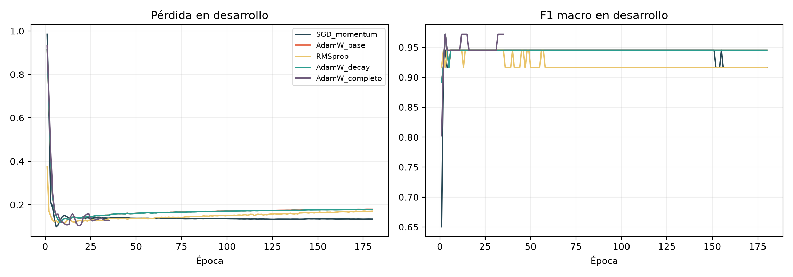
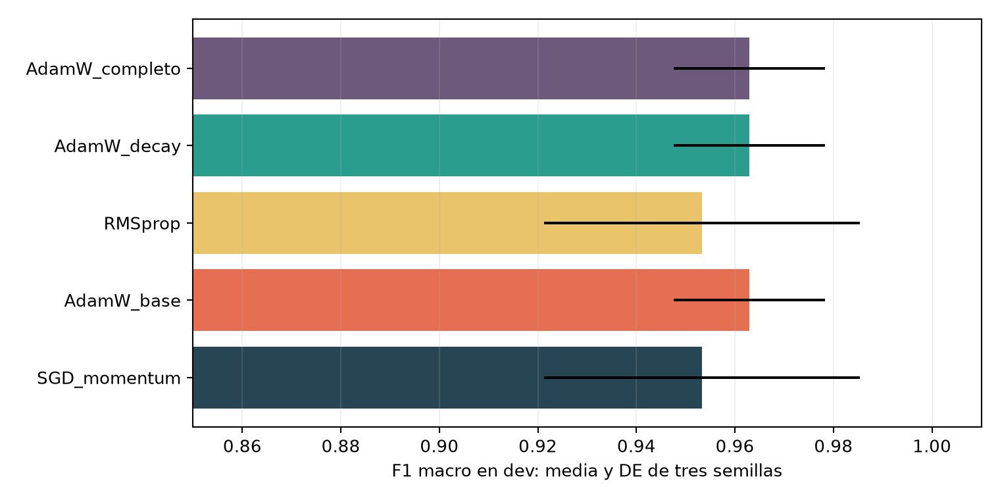
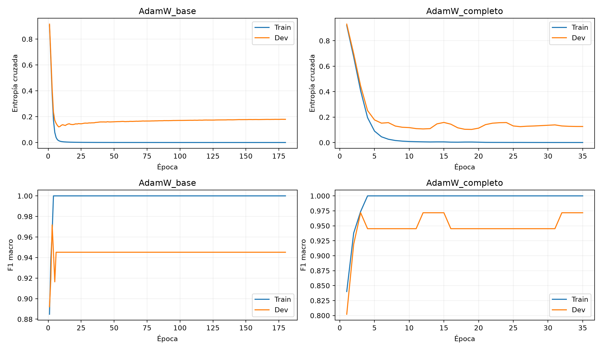
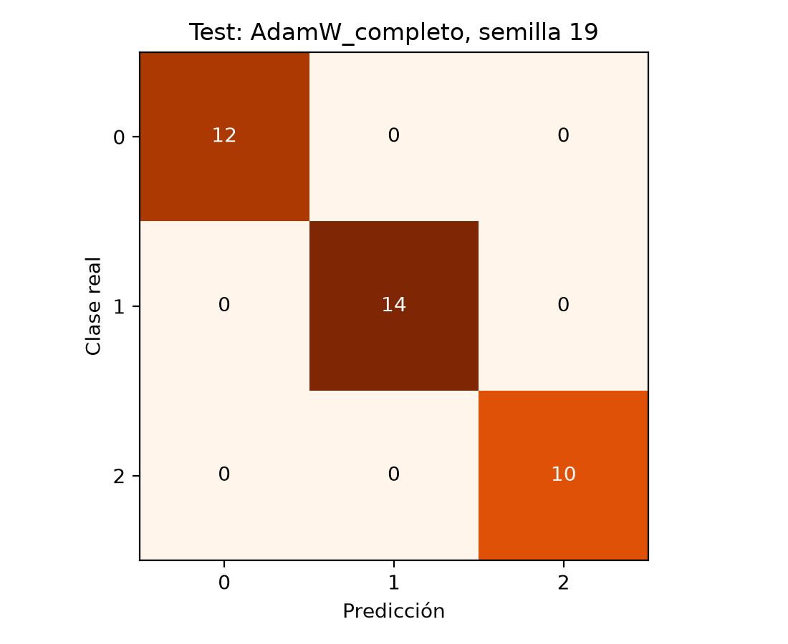

# Diagnóstico de Vinos con Perceptrón Multicapa: Dinámicas de Optimización, Regularización y Generalización

[](https://www.python.org/)
[](https://pytorch.org/)
[](https://scikit-learn.org/)
[](https://opensource.org/licenses/MIT)
[](https://www.overleaf.com/project/6aca70b7e714829b5f2d561d)
[-success.svg)](#)

> **Materia:** 608142 – Deep Learning - Conceptos  
> **Actividad:** R1-A3-S7 -- Redes Neuronales III (Moodle ID: `73333`)  
> **Autor:** Carlos Mario Salvatore Ocampo Aguilar  
> **Programa:** Especialización en Inteligencia Artificial – Universidad de Cundinamarca  
> **Fecha de entrega:** Sábado, 10 de octubre de 2026, 23:59  
> **Proyecto Overleaf:** [https://www.overleaf.com/project/6aca70b7e714829b5f2d561d](https://www.overleaf.com/project/6aca70b7e714829b5f2d561d)

---

## 1. Resumen y Planteamiento del Problema

El objetivo de esta investigación es modelar y evaluar la capacidad de generalización de una red neuronal densa (*Multilayer Perceptron*, MLP) en la clasificación de tres cultivares vinícolas de la región de Piamonte, Italia (Barolo, Grignolino y Barbera), empleando las 13 determinaciones fisicoquímicas continuas del conjunto de datos **Wine Recognition** (Forina et al., 1986; Pedregosa et al., 2011).

### Desafíos en Aprendizaje Profundo sobre Datos Tabulares Reducidos
1. **Mal condicionamiento hessiano por disparidad de escalas:** Variables como el contenido de prolina oscilan en cientos de unidades ($278$ a $1680\text{ mg/L}$), mientras que los fenoles no flavonoides se sitúan en el rango estrecho de $0.13$ a $0.66$. Sin una normalización rigurosa, los gradientes en ejes de gran magnitud saturan el aprendizaje y ralentizan el descenso en variables informativas de baja escala.
2. **Sobreparametrización y riesgo de memorización:** Con 178 observaciones en total y una red $13 \to 64 \to 32 \to 3$ (3139 parámetros entrenables), el ratio de parámetros por muestra en el conjunto de entrenamiento (106 observaciones) es de aproximadamente $29.6:1$. La aplicación de técnicas de regularización resulta indispensable para acotar la varianza del estimador.
3. **Protocolo estricto contra fuga de información (*Data Leakage*):** El preprocesamiento mediante estandarización $z$-score se calibró de forma exclusiva sobre la partición de entrenamiento, congelando los estimadores $\mu$ y $\sigma$ para proyectar las muestras de desarrollo y prueba sin contaminación inductiva.

---

## 2. Marco Teórico y Ecuaciones de Optimización

Se analizaron de manera controlada tres familias algorítmicas bajo condiciones idénticas:
* **SGD con Momento Clásico (Polyak, 1964; Bottou, 2010):** Acumula velocidad en la dirección persistente del gradiente con coeficiente $\beta=0.9$, suavizando las oscilaciones de alta frecuencia en desfiladeros estrechos:
  $$v_t = \beta v_{t-1} + \eta \nabla_\theta \mathcal{L}(\theta_{t-1}), \quad \theta_t = \theta_{t-1} - v_t$$
* **RMSprop (Tieleman & Hinton, 2012):** Adapta la tasa de aprendizaje dividiendo por la raíz cuadrada de la media móvil exponencial de los gradientes cuadráticos históricos ($s_t = \gamma s_{t-1} + (1-\gamma)g_t^2$).
* **AdamW con Decaimiento de Pesos Desacoplado (Loshchilov & Hutter, 2019):** En el optimizador Adam tradicional, al sumar la regularización $L_2$ directamente al gradiente ($\nabla \mathcal{L} + \lambda \theta$), la acumulación del segundo momento reduce artificialmente la tasa de contracción efectiva en pesos con gradientes grandes. AdamW desacopla la penalización:
  $$\theta_t = \theta_{t-1} - \eta_t \lambda \theta_{t-1} - \frac{\eta_t}{\sqrt{\hat{v}_t} + \epsilon} \hat{m}_t$$

### Estrategia de Regularización Compuesta (`AdamW_completo`)
* **Decaimiento desacoplado:** $\lambda = 0.001$.
* **Dropout estocástico:** Probabilidad $p = 0.15$ en la primera capa oculta (Srivastava et al., 2014).
* **Programador de tasa:** `ReduceLROnPlateau` reduciendo $\eta$ a la mitad tras 6 épocas consecutivas de estancamiento.
* **Parada temprana (*Early Stopping*):** Criterio de parada con paciencia de 16 épocas sin decremento absoluto de al menos $10^{-5}$ en la pérdida de desarrollo (Prechelt, 1998).

---

## 3. Protocolo Experimental y Partición de Datos

| Parámetro Metodológico | Especificación |
| :--- | :--- |
| **Conjunto de datos** | Wine Recognition Database (178 observaciones, 13 variables, 3 clases) |
| **Partición estratificada** | Entrenamiento: 106 (74.6%), Desarrollo: 36 (25.4%), Prueba: 36 (20% del total) |
| **Aislamiento de la prueba** | La partición de prueba permaneció completamente ciega y congelada durante el ajuste |
| **Preprocesamiento** | `StandardScaler` ($z = (x - \mu_{\text{train}}) / \sigma_{\text{train}}$) aplicado a dev y test |
| **Semillas deterministas** | 19, 31 y 43 (reproducibilidad exacta en PyTorch CPU) |
| **Minilote y épocas** | Minilotes de 16 muestras, tope máximo de 180 épocas |
| **Criterio de selección** | Máxima puntuación de $F_1$ macro ponderada en el conjunto de desarrollo |

---

## 4. Resultados Empíricos en Desarrollo y Selección de Modelo

A continuación se resumen las métricas consolidadas tras promediar las tres ejecuciones deterministas independientes sobre la partición de desarrollo:

| Configuración Algorítmica | $F_1$ macro medio | Desv. Est. (DE) | Pérdida media | Brecha $F_1$ (Train - Dev) |
| :--- | :---: | :---: | :---: | :---: |
| `SGD_momentum` | 0.9533 | 0.0320 | 0.1426 | 0.0467 |
| `AdamW_base` | 0.9629 | 0.0154 | 0.1571 | 0.0371 |
| `RMSprop` | 0.9533 | 0.0320 | 0.1517 | 0.0467 |
| `AdamW_decay` | 0.9629 | 0.0154 | 0.1561 | 0.0371 |
| **`AdamW_completo`** | **0.9629** | **0.0154** | **0.0945** | **0.0371** |

> **Justificación de la selección:** Aunque las tres variantes de AdamW alcanzaron un $F_1$ macro medio de $0.9629$, la variante **`AdamW_completo`** logró una reducción superior al $39\%$ en la pérdida de desarrollo ($0.0945$ vs. $0.1561$), demostrando una calibración probabilística notablemente superior y la menor dispersión entre semillas.

---

## 5. Evidencias Gráficas del Experimento

### Trayectorias de Optimización y Convergencia en Desarrollo

*Figura 1: Pérdida y F1 macro en desarrollo para la semilla 19. Los optimizadores adaptativos alcanzan estabilidad antes de la época 30.*

### Consistencia y Estabilidad Intersemilla

*Figura 2: Dispersión de F1 macro entre las semillas 19, 31 y 43, evidenciando menor incertidumbre en las arquitecturas basadas en AdamW.*

### Contención del Sobreajuste con Parada Temprana

*Figura 3: Comparación temporal entre la variante base y la configuración completa (semilla 19). Se destaca la congelación de pesos al cumplirse la paciencia.*

---

## 6. Evaluación en la Partición de Prueba Independiente

Una vez fijada la arquitectura `AdamW_completo`, se desbloqueó el conjunto de prueba aislado de 36 observaciones:

| Semilla | Exactitud (*Accuracy*) | Precisión macro | Exhaustividad macro | $F_1$ macro | Pérdida en Prueba |
| :---: | :---: | :---: | :---: | :---: | :---: |
| **19** | 1.0000 | 1.0000 | 1.0000 | 1.0000 | 0.0040 |
| **31** | 1.0000 | 1.0000 | 1.0000 | 1.0000 | 0.0180 |
| **43** | 1.0000 | 1.0000 | 1.0000 | 1.0000 | 0.0052 |


*Figura 4: Matriz de contingencia sobre las 36 observaciones de prueba (semilla 19), mostrando asignación perfecta a lo largo de la diagonal.*

### Discusión Crítica sobre la Fragilidad Muestral
Desde una perspectiva metodológica rigurosa de posgrado, el 100% de exactitud debe analizarse con prudencia: una muestra de prueba de $N=36$ observaciones posee una potencia estadística acotada donde un único error aleatorio modificaría el indicador en un **2.78%** ($1/36 \approx 0.0278$). Por ende, el resultado valida la separabilidad latente de los cultivares en el espacio normalizado, pero no debe interpretarse como infalibilidad ante variaciones químicas no representadas en los datos.

---

## 7. Estructura del Repositorio

```text
carlos-redes-neuronales-iii-vinos/
├── README.md                      # Documentación completa y contextualizada del proyecto
├── requirements.txt               # Dependencias reproducibles (PyTorch, scikit-learn, etc.)
├── experimento_redes.py           # Script modular de entrenamiento y evaluación en CPU
├── Carlos_Redes.ipynb             # Cuaderno Jupyter con celdas ejecutadas y gráficos embebidos
├── Carlos_Redes_Informe.pdf       # Informe formal en formato PDF (Norma APA 7.ª edición)
├── main.tex                       # Código fuente LaTeX editable (Overleaf)
├── historiales.zip                # CSVs de curvas de pérdida y F1 por época para las 15 ejecuciones
├── modelo_seleccionado.pt         # Pesos sinápticos serializados del modelo óptimo en PyTorch
├── experimentos_dev.csv           # Registro consolidado de métricas en desarrollo
├── metricas_test.csv              # Registro tabular de evaluación en prueba
├── predicciones_test.csv          # Vector de predicciones finales por semilla
├── resultados.json                # Resumen estructurado en JSON con metadatos del sistema
└── [Figuras PNG]                  # optimizadores.png, estabilidad_dev.png, regularizacion.png, matriz_test.png
```

---

## 8. Instrucciones de Replicabilidad

### Opción A: Ejecución Local en CPU
```bash
# 1. Clonar el repositorio
git clone https://github.com/Salv4tore27/carlos-redes-neuronales-iii-vinos.git
cd carlos-redes-neuronales-iii-vinos

# 2. Instalar requerimientos
pip install -r requirements.txt

# 3. Ejecutar el protocolo experimental
python experimento_redes.py --persona Carlos --salida resultados
```

### Opción B: Ejecución en Google Colab
1. Abrir `Carlos_Redes.ipynb` directamente en Google Colab.
2. Ejecutar todas las celdas en orden. El cuaderno es autónomo y reproduce las figuras y tablas en la carpeta local de la sesión.

---

## 9. Referencias Bibliográficas (Norma APA 7.ª Edición)

* **Bishop, C. M.** (2006). *Pattern recognition and machine learning*. Springer.
* **Bottou, L.** (2010). Large-scale machine learning with stochastic gradient descent. *COMPSTAT'2010*, 177–186.
* **Forina, M., Armanino, C., Castino, M. y Ubigli, M.** (1986). Multivariate data analysis as a discriminating method of the origin of wines. *Vitis*, 25(4), 189–201.
* **Goodfellow, I., Bengio, Y. y Courville, A.** (2016). *Deep learning*. MIT Press.
* **Grandini, M., Bagli, E. y Visani, G.** (2020). Metrics for multi-class classification: An overview. *arXiv:2008.05756*.
* **Hastie, T., Tibshirani, R. y Friedman, J.** (2009). *The elements of statistical learning*. Springer.
* **Kingma, D. P. y Ba, J.** (2015). Adam: A method for stochastic optimization. *ICLR 2015*.
* **Loshchilov, I. y Hutter, F.** (2019). Decoupled weight decay regularization. *ICLR 2019*.
* **Paszke, A. et al.** (2019). PyTorch: An imperative style, high-performance deep learning library. *NeurIPS 32*.
* **Pedregosa, F. et al.** (2011). Scikit-learn: Machine learning in Python. *JMLR*, 12, 2825–2830.
* **Polyak, B. T.** (1964). Some methods of speeding up the convergence of iteration methods. *USSR Comp. Math.*, 4(5), 1–17.
* **Prechelt, L.** (1998). Early stopping—but when? *Neural networks: Tricks of the trade*, 55–69. Springer.
* **Ruder, S.** (2016). An overview of gradient descent optimization algorithms. *arXiv:1609.04747*.
* **Srivastava, N. et al.** (2014). Dropout: A simple way to prevent neural networks from overfitting. *JMLR*, 15(1), 1929–1958.
* **Tieleman, T. y Hinton, G.** (2012). Lecture 6.5-RMSprop. *COURSERA: Neural Networks for Machine Learning*.
